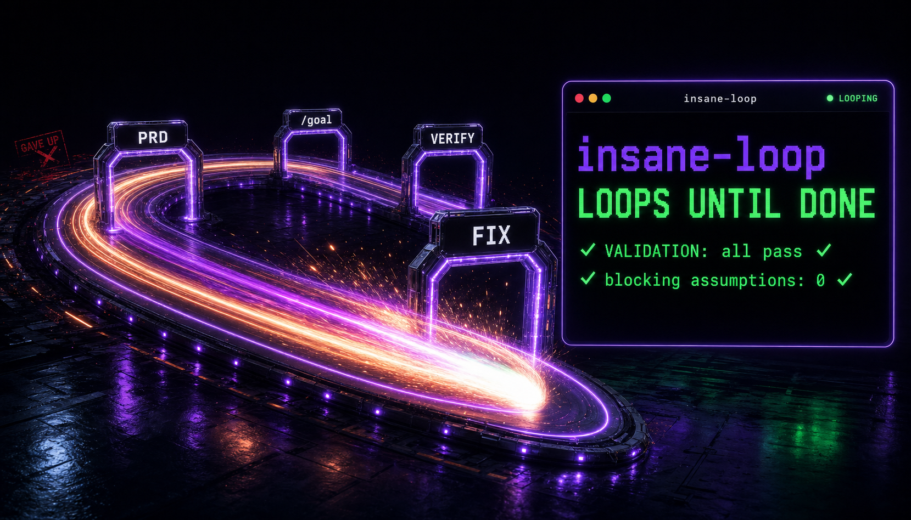

[English](README.md) | [한국어](README.ko.md) | [中文](README.zh.md) | [日本語](README.ja.md) | Español

# insane-loop

<div align="center">
  
</div>

> **De la idea al hecho — un bucle de pipeline dirigido por objetivos que se niega a parar hasta que los documentos digan que está terminado.**

insane-loop encadena el pipeline de gptaku — entrevista→PRD (`/show-me-the-prd`), preparación del objetivo (`/goaljaby`), ejecución de `/goal` — y luego sigue iterando ciclos de **verify → review → improve** *dentro del objetivo* hasta cumplir la Definition of Done documentada: **todos los ítems de VALIDATION pasan Y quedan cero suposiciones bloqueantes**. Cuando el progreso se estanca, una escalera de recuperación cambia el enfoque en lugar de rendirse; cuando el objetivo intenta parar antes de tiempo, la guardia driven lo devuelve al bucle. No es perfección de un solo intento — son microbucles implacables.

[Inicio rápido](#inicio-rápido) • [¿Por qué insane-loop?](#por-qué-insane-loop) • [Cómo funciona](#cómo-funciona) • [Revisores](#revisores) • [Salidas](#salidas) • [Requisitos](#requisitos)

---

## Inicio rápido

### 1. Añade el marketplace

```
/plugin marketplace add https://github.com/fivetaku/gptaku_plugins.git
```

### 2. Instala

```
/plugin install insane-loop
```

### 3. Reinicia Claude Code

### 4. Ejecuta — desde cualquier punto del pipeline

```
/insane-loop a workout tracker for my gym friends   # from a raw idea
/insane-loop /path/to/my-project                    # detects PRD / goal state and joins there
/insane-loop                                        # resume: picks up LOOP.md where it stopped
```

## ¿Por qué insane-loop?

Cada etapa ya tiene su plugin — pero las transiciones son manuales, el contexto muere entre etapas y los objetivos se detienen en silencio tras unos pocos intentos fallidos. insane-loop arregla las tres cosas:

1. **Enrutado de etapas** — detecta dónde estás (en blanco / PRD / objetivo en marcha / bucle estancado) y se incorpora ahí.
2. **Contexto que fluye** — el libro de suposiciones del PRD alimenta los ítems de VALIDATION; los fallos de verificación se convierten en la entrada del siguiente ciclo de mejora.
3. **Guardia driven** — "parado pero no terminado" no es un estado final. El bucle vuelve a entrar por la escalera de recuperación hasta cumplir la DoD.

## Cómo funciona

```
idea ──▶ /show-me-the-prd ──▶ /goaljaby (+ loop-aware RECOVERY) ──▶ /goal
                                                                     │
                 ┌── verify ── review ── improve ── re-verify ──┐    │
                 └──────────────── repeat ◀─────────────────────┘◀───┘
                                   until: all VALIDATION pass + 0 blocking assumptions
```

**Escalera de recuperación** (se escribe en RECOVERY.md al preparar el objetivo, para que el objetivo sobreviva de forma autónoma):

| Paso | Disparador | Respuesta |
|---|---|---|
| 1 Reintentar | un fallo aislado | corregir con el mismo enfoque y volver a verificar |
| 2 Cambiar de enfoque | el mismo ítem falla 2 ciclos | traer al revisor profundo / autorrevisión adversarial — otro ángulo |
| 3 Replanificar | 3 fallos consecutivos o hueco estructural | `gate_pending`: una pregunta de dirección al usuario, y de vuelta al bucle |

Solo orquestación: los subplugins y revisores se invocan **tal cual** — sin adaptadores, sin contratos de salida forzados, sin saltarse puertas (la puerta de aprobación humana de goaljaby se mantiene).

## Revisores

Se eligen una vez al preparar el bucle (solo se ofrecen los detectados) y quedan registrados en `LOOP.md`:

| Revisor | Cuándo | Notas |
|---|---|---|
| Autorrevisión (por defecto) | cada ciclo | coste cero — los microbucles tienen que ser baratos para correr a menudo |
| insane-review | paso 2 de la escalera / hitos | diagnóstico cruzado con GPT-5.5 Pro (suscripción ChatGPT Pro) |
| codex | paso 2 de la escalera / hitos | contraste cruzado con Codex CLI |
| gjc | paso 2 de la escalera / hitos | contraste multimodelo con gajae-code |

## Salidas

- `LOOP.md` — un único archivo de bitácora en la raíz del proyecto: DoD, configuración de revisores, un bloque por ciclo (resultados de verificación / paso de la escalera / tareas aplicadas / veredicto). También es el punto de reanudación — mata la sesión cuando quieras: `/insane-loop` continúa desde el último bloque.
- Todo lo demás lo producen los subplugins que ya conoces (PRD/, VALIDATION.md, RECOVERY.md, …).

## Requisitos

- Claude Code con soporte de `/goal`
- Dependencias blandas (cada etapa degrada con elegancia si falta): [show-me-the-prd](https://github.com/fivetaku/show-me-the-prd), [goaljaby](https://github.com/fivetaku/goaljaby)
- Revisores opcionales: insane-review (ChatGPT Pro), Codex CLI, gajae-code CLI

## Licencia

MIT — consulta [LICENSE](./LICENSE) y [DISCLAIMER.md](./DISCLAIMER.md).
