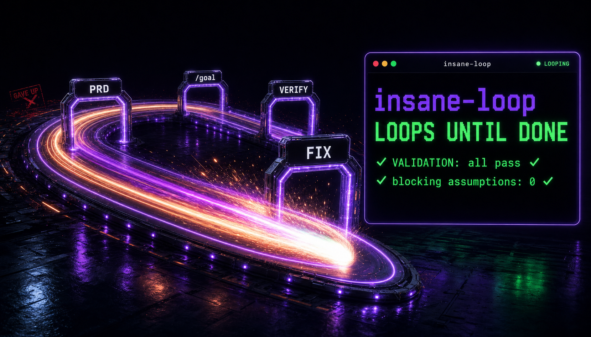

[English](README.md) | [한국어](README.ko.md) | [中文](README.zh.md) | 日本語 | [Español](README.es.md)

# insane-loop

<div align="center">
  
</div>

> **アイデアから完成まで — ドキュメントが「終わった」と言うまで止まらない、ゴール駆動のパイプラインループ。**

insane-loop は gptaku パイプライン — インタビュー→PRD（`/show-me-the-prd`）、ゴールセットアップ（`/goaljaby`）、`/goal` 実行 — を連結し、さらにゴールの*内側で* **verify → review → improve** のサイクルを回し続けます。終了条件はドキュメントに定義された Definition of Done：**VALIDATION の全項目がパスし、かつ blocking な仮定がゼロ**。進捗が止まれば、諦める代わりにリカバリーラダーがアプローチを変え、ゴールが早期終了しようとすれば、driven ガードがループへ再突入させます。一発完璧ではなく、執拗なマイクロループです。

[クイックスタート](#クイックスタート) • [なぜ insane-loop？](#なぜ-insane-loop) • [仕組み](#仕組み) • [レビュアー](#レビュアー) • [成果物](#成果物) • [要件](#要件)

---

## クイックスタート

### 1. マーケットプレイスを追加

```
/plugin marketplace add https://github.com/fivetaku/gptaku_plugins.git
```

### 2. インストール

```
/plugin install insane-loop
```

### 3. Claude Code を再起動

### 4. 実行 — パイプラインのどこからでも

```
/insane-loop a workout tracker for my gym friends   # from a raw idea
/insane-loop /path/to/my-project                    # detects PRD / goal state and joins there
/insane-loop                                        # resume: picks up LOOP.md where it stopped
```

## なぜ insane-loop？

各ステージにはすでにプラグインがある — しかし遷移はすべて手動で、ステージ間でコンテキストが途切れ、ゴールは数回失敗すると静かに止まってしまう。insane-loop はこの 3 つを直します：

1. **ステージルーティング** — 現在地（白紙 / PRD あり / ゴール進行中 / 停滞したループ）を検出し、その地点から合流します。
2. **コンテキスト引き継ぎ** — PRD の仮定台帳が VALIDATION 項目へ流れ込み、検証の失敗が次の改善サイクルの入力になります。
3. **driven ガード** — 「止まったが未完成」は終着点ではありません。DoD を満たすまで、リカバリーラダー経由でループに再突入します。

## 仕組み

```
idea ──▶ /show-me-the-prd ──▶ /goaljaby (+ loop-aware RECOVERY) ──▶ /goal
                                                                     │
                 ┌── verify ── review ── improve ── re-verify ──┐    │
                 └──────────────── repeat ◀─────────────────────┘◀───┘
                                   until: all VALIDATION pass + 0 blocking assumptions
```

**リカバリーラダー**（ゴールセットアップ時に RECOVERY.md へ書き込まれるため、ゴールは自律走行中も生き延びます）：

| ステップ | トリガー | 対応 |
|---|---|---|
| 1 リトライ | 単発の失敗 | 同じアプローチで修正して再検証 |
| 2 アプローチ変更 | 同じ項目が 2 サイクル連続で失敗 | ディープレビュアー / 敵対的セルフレビューを投入 — 別の角度から |
| 3 再計画 | 3 連続失敗、または構造的なギャップ | `gate_pending`：ユーザーへ方向性の質問を 1 つ投げてから再突入 |

やるのはオーケストレーションだけ：サブプラグインとレビュアーは**そのまま**呼び出します — アダプターなし、出力契約の強制なし、ゲートのバイパスなし（goaljaby の人間承認ゲートは維持）。

## レビュアー

ループセットアップ時に一度だけ選択（検出されたものだけが提示される）、`LOOP.md` に記録されます：

| レビュアー | タイミング | 備考 |
|---|---|---|
| セルフレビュー（デフォルト） | 毎サイクル | コストゼロ — マイクロループは安くなければ頻繁に回せない |
| insane-review | ラダーのステップ 2 / マイルストーン | GPT-5.5 Pro クロスモデル診断（ChatGPT Pro サブスクリプション） |
| codex | ラダーのステップ 2 / マイルストーン | Codex CLI クロスチェック |
| gjc | ラダーのステップ 2 / マイルストーン | gajae-code マルチモデルクロスチェック |

## 成果物

- `LOOP.md` — プロジェクトルートの単一ジャーナルファイル：DoD、レビュアー設定、サイクルごとに 1 ブロック（検証結果 / ラダーのステップ / 適用タスク / 判定）。再開ポイントでもあります — いつセッションを落としても、`/insane-loop` が最後のブロックから続行します。
- それ以外はすべて、おなじみのサブプラグインが生成します（PRD/、VALIDATION.md、RECOVERY.md、…）。

## 要件

- `/goal` をサポートする Claude Code
- ソフト依存（欠けていても各ステージは適切にフォールバック）：[show-me-the-prd](https://github.com/fivetaku/show-me-the-prd)、[goaljaby](https://github.com/fivetaku/goaljaby)
- オプションのレビュアー：insane-review（ChatGPT Pro）、Codex CLI、gajae-code CLI

## ライセンス

MIT — [LICENSE](./LICENSE) と [DISCLAIMER.md](./DISCLAIMER.md) を参照。
