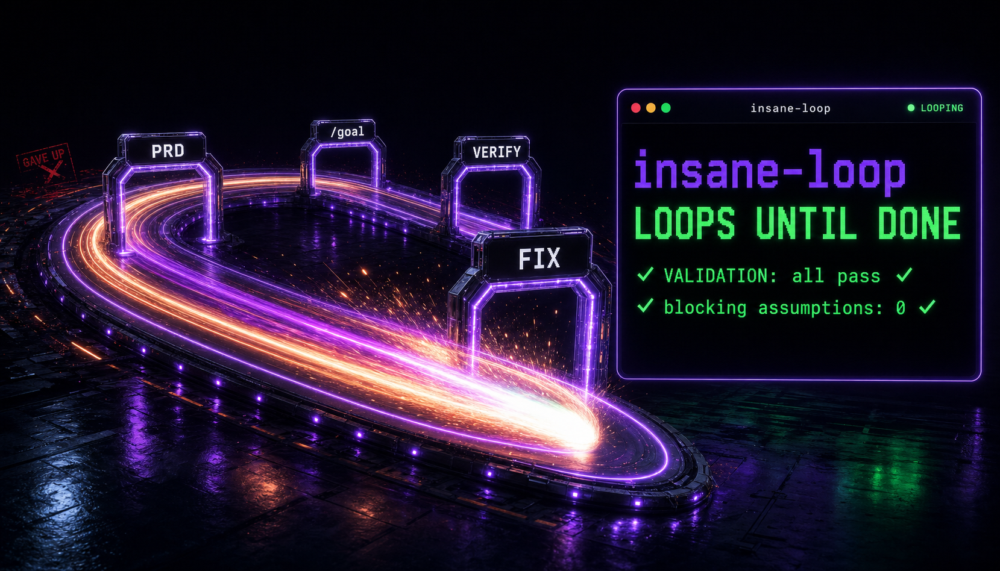

[English](README.md) | 한국어 | [中文](README.zh.md) | [日本語](README.ja.md) | [Español](README.es.md)

# insane-loop

<div align="center">
  
</div>

> **아이디어부터 완성까지 — 문서가 "끝났다"고 말할 때까지 멈추지 않는 골 드리븐 파이프라인 루프.**

insane-loop는 gptaku 파이프라인 — 인터뷰→PRD(`/show-me-the-prd`), 골 셋업(`/goaljaby`), `/goal` 실행 — 을 이어 붙이고, 골 **안에서** **검증 → 리뷰 → 개선** 회차를 계속 돌린다. 종료 조건은 문서로 정의된 완성(DoD): **VALIDATION 전체 통과 + blocking 가정 0**. 진행이 막히면 포기하는 대신 리커버리 사다리가 접근을 바꾸고, 골이 조기 종료하려 하면 드리븐 가드가 루프에 재진입시킨다. 한방 완성이 아니라, 집요한 미세 루프.

[빠른 시작](#빠른-시작) • [왜 insane-loop인가](#왜-insane-loop인가) • [작동 방식](#작동-방식) • [리뷰어](#리뷰어) • [생성 파일](#생성-파일) • [요구사항](#요구사항)

---

## 빠른 시작

### 1. 마켓플레이스 등록

```
/plugin marketplace add https://github.com/fivetaku/gptaku_plugins.git
```

### 2. 설치

```
/plugin install insane-loop
```

### 3. Claude Code 재시작

### 4. 실행 — 파이프라인 어디서든 합류

```
/insane-loop 헬스장 친구들이랑 쓸 운동 기록 앱     # 아이디어부터
/insane-loop /path/to/my-project                # PRD·골 상태를 감지해 그 지점부터
/insane-loop                                    # 재개: LOOP.md의 멈춘 회차부터
```

## 왜 insane-loop인가

스테이지마다 플러그인은 이미 있다 — 그런데 전환이 전부 수동이고, 단계 사이에서 컨텍스트가 끊기고, 골은 몇 번 실패하면 조용히 멈춘다. insane-loop는 이 셋을 고친다:

1. **스테이지 라우팅** — 현재 상태(백지 / PRD / 골 진행 중 / 멈춘 루프)를 감지해 그 지점부터 합류.
2. **컨텍스트 관통** — PRD의 가정 원장이 VALIDATION 항목으로 흘러가고, 검증 실패가 다음 개선 회차의 입력이 된다.
3. **드리븐 가드** — "멈췄는데 미완성"은 종착지가 아니다. DoD 충족까지 리커버리 사다리로 재진입한다.

## 작동 방식

```
아이디어 ──▶ /show-me-the-prd ──▶ /goaljaby (+루프형 RECOVERY) ──▶ /goal
                                                                    │
                  ┌── 검증 ── 리뷰 ── 개선 ── 재검증 ──┐              │
                  └────────────── 반복 ◀─────────────┘◀─────────────┘
                        종료: VALIDATION 전체 통과 + blocking 가정 0
```

**리커버리 사다리** (골 셋업 때 RECOVERY.md에 새겨져 자율 주행 중에도 살아남는다):

| 단계 | 트리거 | 대응 |
|---|---|---|
| 1 재시도 | 단발 실패 | 같은 접근으로 수정 후 재검증 |
| 2 접근 변경 | 같은 항목 2회차 연속 실패 | 딥 리뷰어 투입 / 반박 관점 셀프리뷰 — 다른 각도로 |
| 3 재계획 | 3회 연속 실패 or 구조적 갭 | `gate_pending`: 골을 멈추고 막힌 작업을 `[!]`로 표시, 다시 들어올 때 방향 질문 1개 후 재진입 |

오케스트레이션만 한다: 하위 플러그인과 리뷰어는 **있는 그대로** 호출 — 어댑터 없음, 출력 계약 강제 없음, 게이트 우회 없음(goaljaby 사람 승인 게이트 유지).

## 리뷰어

루프 시작 전 1회 선택(감지된 것만 노출), `LOOP.md`에 기록:

| 리뷰어 | 투입 시점 | 비고 |
|---|---|---|
| 셀프리뷰 (기본) | 매 회차 | 비용 제로 — 미세 루프는 싸야 자주 돈다 |
| insane-review | 사다리 2단 / 마일스톤 | ChatGPT Pro 최신 모델 교차진단 (ChatGPT Pro 구독, 추론 강도 기본 Pro) |
| codex | 사다리 2단 / 마일스톤 | Codex CLI 교차검토 |
| gjc | 사다리 2단 / 마일스톤 | gajae-code 멀티모델 교차검토 |
| pumasi 후보 경쟁 | 사다리 2단 | 설계 방향이 갈릴 때 외부 워커 2개가 다른 접근안을 쓰고 하나를 고른다 |

## 보드 — playmaker

[playmaker](https://github.com/fivetaku/playmaker)가 설치돼 있으면 `/goal` 시작과 함께 골 보드가 저절로 열린다. 작업 카드(PLAN.md `[ ]`/`[>]`/`[x]`/`[!]`)와 루프 줄(회차·검증 x/y·사다리 단계·⏸ 판단 대기)을 함께 보여 주고, 카드에서 'gate 답하기'·'접근 바꿔서 다시'·'DoD 다시 판정'을 바로 보낼 수 있다. 이때 관제탑은 따로 띄우지 않는다.

## 관제탑 (tower)

```
/insane-loop:tower
```

루프가 남기는 파일(LOOP.md·PRD/·goaljaby 산출물)을 감시해 공정 레일(A→D)·회차 타임라인·DoD 게이지·gate_pending 배너를 브라우저(127.0.0.1)에서 실시간(SSE)으로 보여주는 MES식 상황판. 읽기 전용·zero-dep — 루프를 제어하지 않고 지켜보기만 한다. 여러 프로젝트의 루프는 카드로 분리 집계된다. 데모: `node skills/insane-loop/scripts/simulate-loop.mjs`

## 생성 파일

- `LOOP.md` — 프로젝트 루트의 저널 단일 파일: DoD·리뷰어 설정·회차별 블록(검증 결과/사다리 단계/적용 태스크/판정). **재개 지점**이기도 하다 — 세션이 죽어도 `/insane-loop`가 마지막 블록부터 잇는다.
- 나머지는 익숙한 하위 플러그인 산출물 그대로 (PRD/, VALIDATION.md, RECOVERY.md, …).

## 요구사항

- `/goal`을 지원하는 Claude Code
- 소프트 의존 (없으면 해당 스테이지만 폴백): [show-me-the-prd](https://github.com/fivetaku/show-me-the-prd), [goaljaby](https://github.com/fivetaku/goaljaby), [playmaker](https://github.com/fivetaku/playmaker)
- 선택 리뷰어: insane-review(ChatGPT Pro), pumasi(후보 경쟁), Codex CLI, gajae-code CLI

## 라이선스

MIT — [LICENSE](./LICENSE) · [DISCLAIMER.md](./DISCLAIMER.md)
