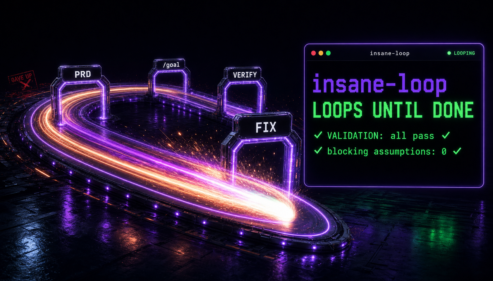

English | [한국어](README.ko.md) | [中文](README.zh.md) | [日本語](README.ja.md) | [Español](README.es.md)

# insane-loop

<div align="center">
  
</div>

> **Idea to done — a goal-driven pipeline loop that refuses to stop until the documents say it's finished.**

insane-loop chains the gptaku pipeline — interview→PRD (`/show-me-the-prd`), goal setup (`/goaljaby`), `/goal` execution — and then keeps iterating **verify → review → improve** cycles *inside the goal* until the documented Definition of Done is met: **every VALIDATION item passes AND zero blocking assumptions remain**. When progress stalls, a recovery ladder changes the approach instead of giving up; when the goal tries to stop early, the driven guard re-enters the loop. Not one-shot perfection — relentless micro-loops.

[Quick Start](#quick-start) • [Why insane-loop?](#why-insane-loop) • [How it works](#how-it-works) • [Reviewers](#reviewers) • [Outputs](#outputs) • [Requirements](#requirements)

---

## Quick Start

### 1. Add the marketplace

```
/plugin marketplace add https://github.com/fivetaku/gptaku_plugins.git
```

### 2. Install

```
/plugin install insane-loop
```

Codex: `codex plugin marketplace add fivetaku/gptaku_plugins`, then `codex plugin add insane-loop@gptaku-plugins`.

### 3. Restart Claude Code

### 4. Run — from anywhere in the pipeline

```
/insane-loop a workout tracker for my gym friends   # from a raw idea
/insane-loop /path/to/my-project                    # detects PRD / goal state and joins there
/insane-loop                                        # resume: picks up LOOP.md where it stopped
```

## Why insane-loop?

Every stage already has a plugin — but the transitions are manual, context dies between stages, and goals quietly stop after a few failed attempts. insane-loop fixes all three:

1. **Stage routing** — detects where you are (blank / PRD / goal in flight / stalled loop) and joins there.
2. **Context carry** — the PRD's assumption ledger flows into VALIDATION items; verification failures become the input for the next improvement cycle.
3. **Driven guard** — "stopped but not done" is not a terminal state. The loop re-enters via the recovery ladder until the DoD is met.

## How it works

```
idea ──▶ /show-me-the-prd ──▶ /goaljaby (+ loop-aware RECOVERY) ──▶ /goal
                                                                     │
                 ┌── verify ── review ── improve ── re-verify ──┐    │
                 └──────────────── repeat ◀─────────────────────┘◀───┘
                                   until: all VALIDATION pass + 0 blocking assumptions
```

**Recovery ladder** (written into RECOVERY.md at goal setup, so the goal survives autonomously):

| Step | Trigger | Response |
|---|---|---|
| 1 Retry | single failure | fix with the same approach, re-verify |
| 2 Change approach | same item fails 2 cycles | bring in the deep reviewer / adversarial self-review — different angle |
| 3 Re-plan | 3 consecutive failures or structural gap | `gate_pending`: stop the goal and mark the stuck task `[!]`; on re-entry, one direction question, then continue |

Orchestration only: sub-plugins and reviewers are invoked **as-is** — no adapters, no forced output contracts, no gate bypassing (goaljaby's human-approval gate stays).

## Reviewers

Chosen once at loop setup (only detected ones are offered), recorded in `LOOP.md`:

| Reviewer | When | Notes |
|---|---|---|
| Self-review (default) | every cycle | zero cost — micro-loops must be cheap to run often |
| insane-review | ladder step 2 / milestones | cross-model diagnosis with the latest ChatGPT Pro model (ChatGPT Pro subscription, effort defaults to Pro) |
| codex | ladder step 2 / milestones | Codex CLI cross-check |
| gjc | ladder step 2 / milestones | gajae-code multi-model cross-check |
| pumasi candidates | ladder step 2 | when the design direction is split, two outside workers write different approaches and one is picked |

## Board — playmaker

If [playmaker](https://github.com/fivetaku/playmaker) is installed, the goal board opens on its own when `/goal` starts. It shows task cards (PLAN.md `[ ]`/`[>]`/`[x]`/`[!]`) plus a loop line (round · checks x/y · ladder step · ⏸ waiting for your call), and cards can send 'answer the gate', 'retry with a new approach' and 'recheck DoD'. The tower is not offered in that case.

## Tower

```
/insane-loop:tower
```

An MES-style live board that watches the files the loop leaves behind (LOOP.md, PRD/, goaljaby outputs) and renders the stage rail (A→D), round timeline, DoD gauge, and gate_pending banner in your browser (127.0.0.1) over SSE. Read-only and zero-dep — it observes the loop, never controls it. Multiple projects show up as separate cards. Demo: `node skills/insane-loop/scripts/simulate-loop.mjs`

## Outputs

- `LOOP.md` — single journal file at the project root: DoD, reviewer config, one block per cycle (verification results / ladder step / applied tasks / verdict). It is also the resume point — kill the session anytime, `/insane-loop` continues from the last block.
- Everything else is produced by the sub-plugins you already know (PRD/, VALIDATION.md, RECOVERY.md, …).

## Requirements

- Claude Code with `/goal` support
- Soft dependencies (each stage falls back gracefully if missing): [show-me-the-prd](https://github.com/fivetaku/show-me-the-prd), [goaljaby](https://github.com/fivetaku/goaljaby), [playmaker](https://github.com/fivetaku/playmaker)
- Optional reviewers: insane-review (ChatGPT Pro), pumasi (candidates), Codex CLI, gajae-code CLI

## License

MIT — see [LICENSE](./LICENSE) and [DISCLAIMER.md](./DISCLAIMER.md).
