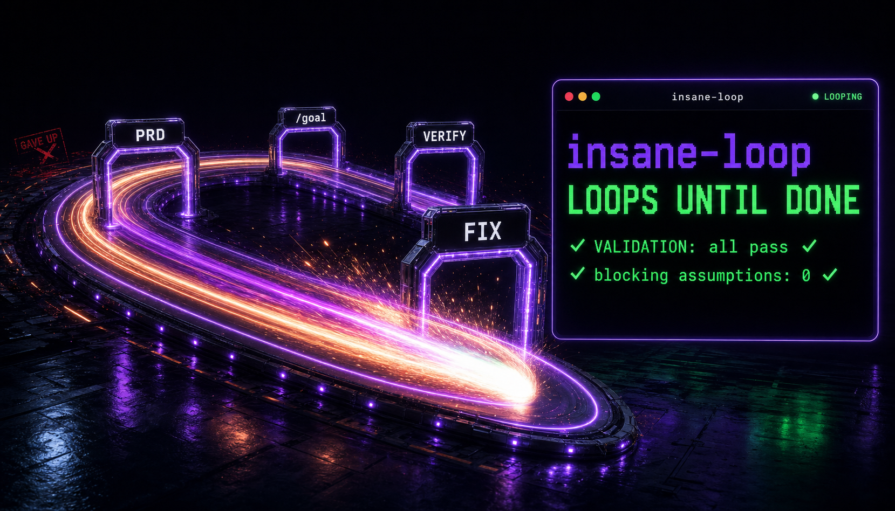

[English](README.md) | [한국어](README.ko.md) | 中文 | [日本語](README.ja.md) | [Español](README.es.md)

# insane-loop

<div align="center">
  
</div>

> **从想法到完成 — 一个目标驱动的流水线循环，在文档宣告「完成」之前拒绝停下。**

insane-loop 把 gptaku 流水线串成一体 — 访谈→PRD（`/show-me-the-prd`）、目标搭建（`/goaljaby`）、`/goal` 执行 — 然后继续在目标*内部*反复运转 **verify → review → improve** 循环，直到满足文档定义的 Definition of Done：**VALIDATION 全部通过，且 blocking 假设为零**。进度卡住时，恢复阶梯会换一种打法而不是放弃；目标想提前收工时，driven 守卫会把它拽回循环。不求一次完美，只求不懈的微循环。

[快速开始](#快速开始) • [为什么选 insane-loop？](#为什么选-insane-loop) • [工作原理](#工作原理) • [评审者](#评审者) • [产出](#产出) • [环境要求](#环境要求)

---

## 快速开始

### 1. 添加市场

```
/plugin marketplace add https://github.com/fivetaku/gptaku_plugins.git
```

### 2. 安装

```
/plugin install insane-loop
```

### 3. 重启 Claude Code

### 4. 运行 — 从流水线的任意位置切入

```
/insane-loop a workout tracker for my gym friends   # from a raw idea
/insane-loop /path/to/my-project                    # detects PRD / goal state and joins there
/insane-loop                                        # resume: picks up LOOP.md where it stopped
```

## 为什么选 insane-loop？

每个阶段其实都已经有插件了 — 但阶段之间的切换全靠手动，上下文在阶段间断掉，目标失败几次后就悄悄停摆。insane-loop 把这三个问题都修掉：

1. **阶段路由** — 检测你当前所处的位置（空白 / 已有 PRD / 目标进行中 / 循环停滞），从那里直接接入。
2. **上下文贯通** — PRD 的假设台账流入 VALIDATION 条目；验证失败成为下一轮改进循环的输入。
3. **driven 守卫** — 「停了但没完成」不是终点。循环会经由恢复阶梯重新进入，直到满足 DoD。

## 工作原理

```
idea ──▶ /show-me-the-prd ──▶ /goaljaby (+ loop-aware RECOVERY) ──▶ /goal
                                                                     │
                 ┌── verify ── review ── improve ── re-verify ──┐    │
                 └──────────────── repeat ◀─────────────────────┘◀───┘
                                   until: all VALIDATION pass + 0 blocking assumptions
```

**恢复阶梯**（在目标搭建时写入 RECOVERY.md，因此目标能自主存活）：

| 步骤 | 触发条件 | 应对 |
|---|---|---|
| 1 重试 | 单次失败 | 沿用原方案修复，再验证 |
| 2 更换打法 | 同一条目连续 2 轮失败 | 引入深度评审者 / 对抗式自评 — 换个角度 |
| 3 重新规划 | 连续 3 次失败或存在结构性缺口 | `gate_pending`：向用户提一个方向性问题，然后重新进入循环 |

只做编排：子插件与评审者一律**原样**调用 — 不加适配器、不强加输出契约、不绕过关卡（goaljaby 的人工审批关卡保持不动）。

## 评审者

在循环搭建时一次性选定（只展示已检测到的），记录在 `LOOP.md` 中：

| 评审者 | 时机 | 说明 |
|---|---|---|
| 自评（默认） | 每轮循环 | 零成本 — 微循环必须足够便宜才能高频运转 |
| insane-review | 阶梯第 2 步 / 里程碑 | GPT-5.5 Pro 跨模型诊断（需 ChatGPT Pro 订阅） |
| codex | 阶梯第 2 步 / 里程碑 | Codex CLI 交叉核查 |
| gjc | 阶梯第 2 步 / 里程碑 | gajae-code 多模型交叉核查 |

## 产出

- `LOOP.md` — 项目根目录下的单一日志文件：DoD、评审者配置、每轮循环一个区块（验证结果 / 阶梯步骤 / 已应用任务 / 判定）。它同时也是续跑点 — 随时杀掉会话，`/insane-loop` 会从最后一个区块继续。
- 其余产出都来自你熟悉的子插件（PRD/、VALIDATION.md、RECOVERY.md 等）。

## 环境要求

- 支持 `/goal` 的 Claude Code
- 软依赖（缺失时对应阶段会优雅回退）：[show-me-the-prd](https://github.com/fivetaku/show-me-the-prd)、[goaljaby](https://github.com/fivetaku/goaljaby)
- 可选评审者：insane-review（ChatGPT Pro）、Codex CLI、gajae-code CLI

## 许可证

MIT — 参见 [LICENSE](./LICENSE) 与 [DISCLAIMER.md](./DISCLAIMER.md)。
